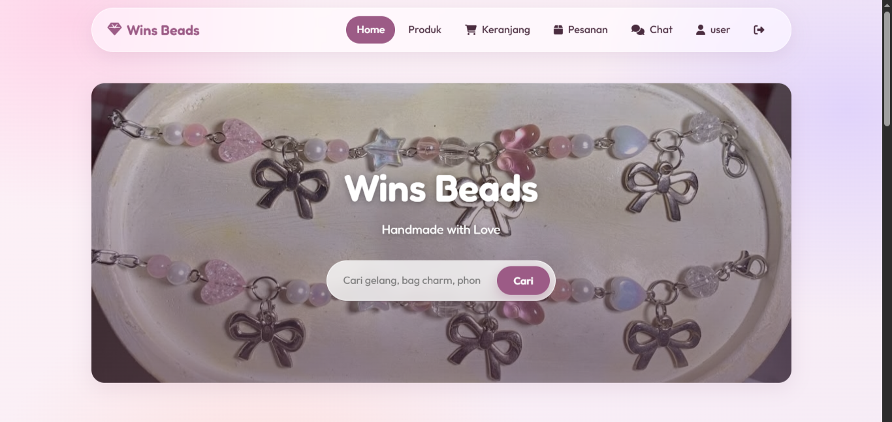
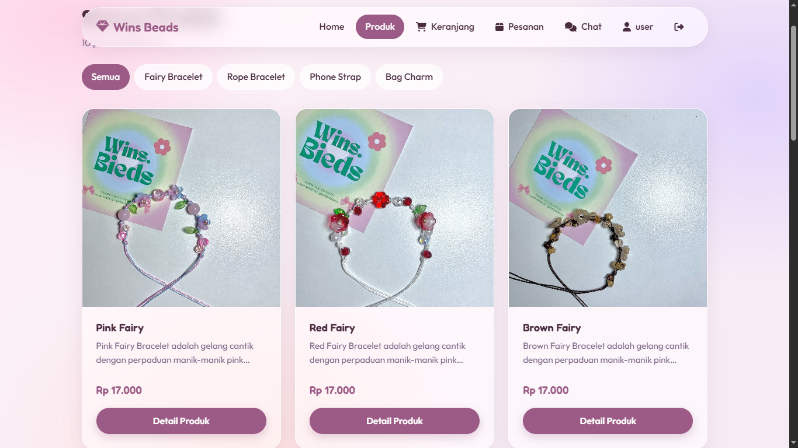
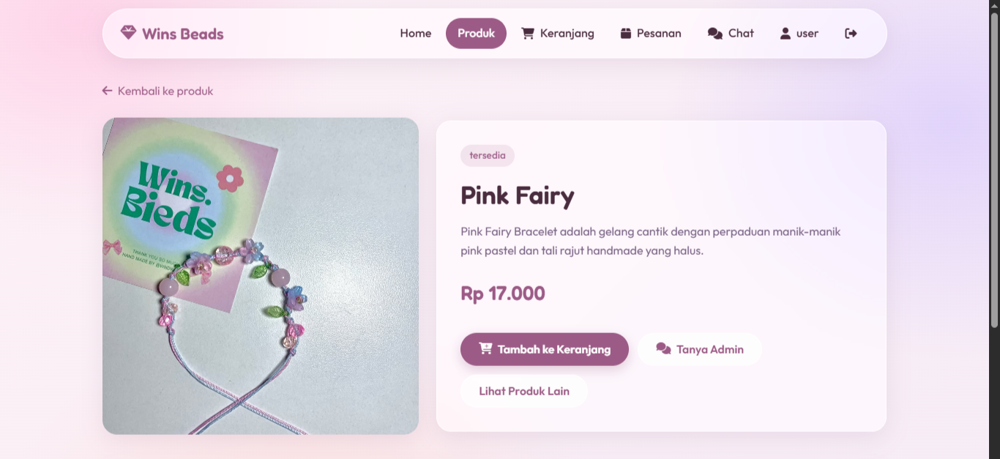
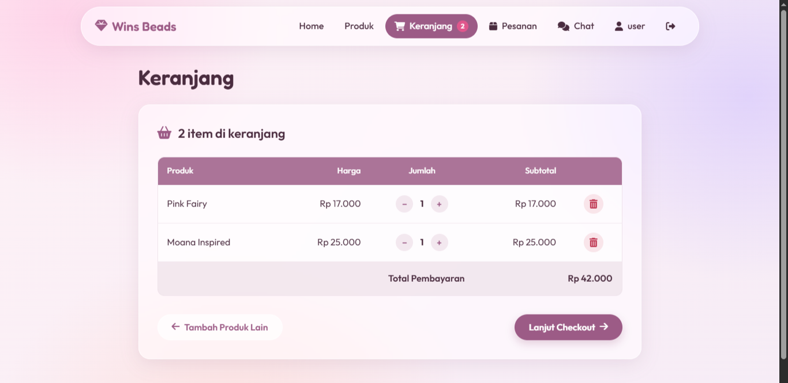
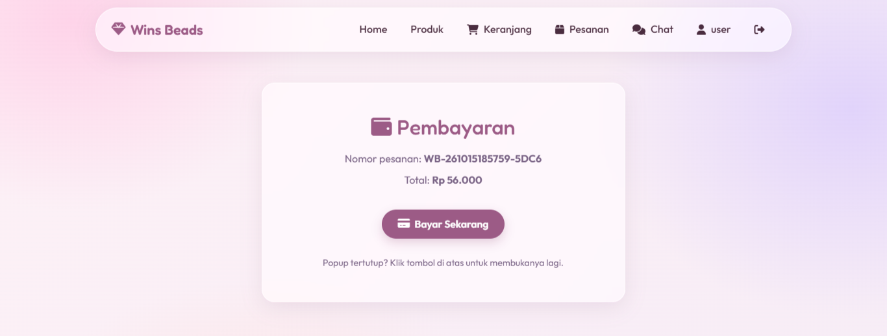
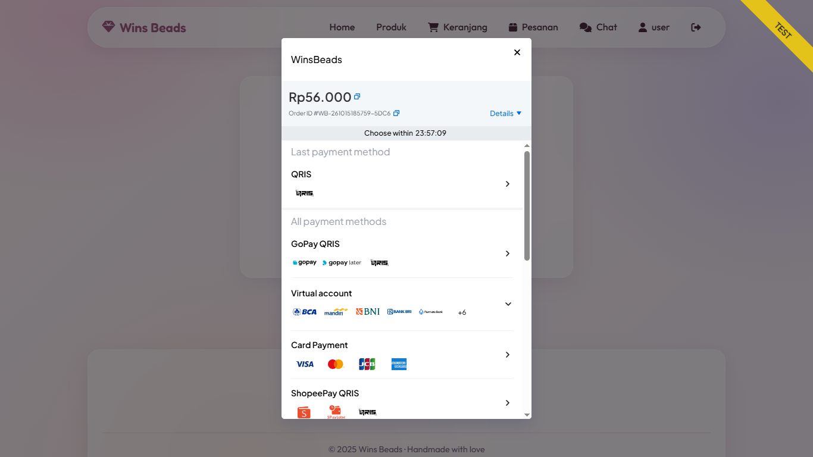
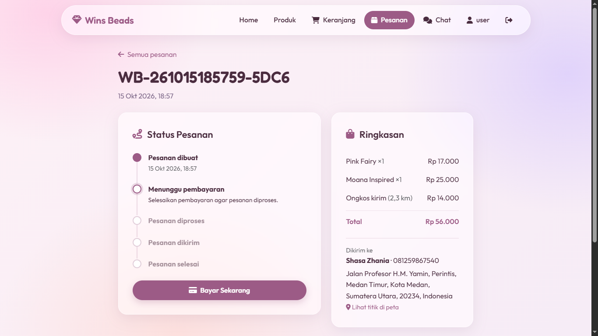
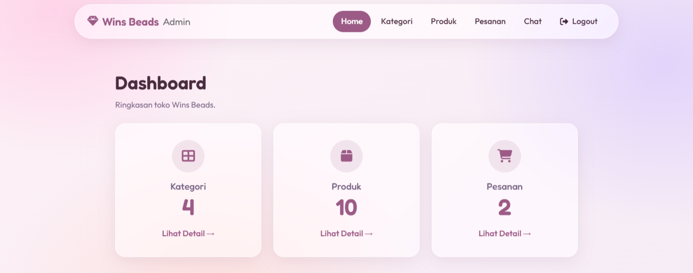
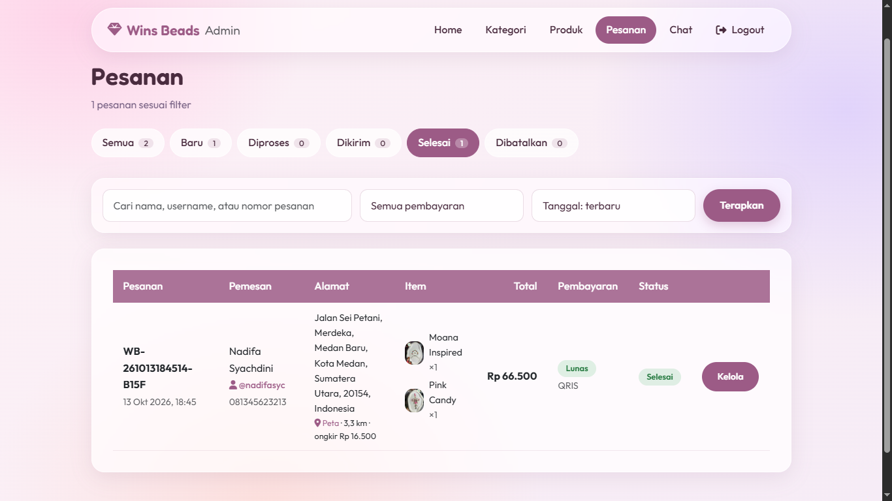
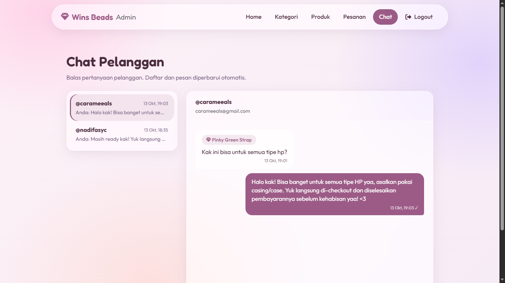

# Wins Beads — E-Commerce Aksesori Handmade

Wins Beads adalah aplikasi e-commerce berbasis web untuk menjual aksesori handmade berbahan manik-manik, seperti gelang, hiasan tas (*bag charm*), dan tali ponsel (*phone strap*).

Proyek ini dikembangkan sebagai portofolio untuk menunjukkan keterampilan pengembangan web menggunakan PHP Native dan MySQL, dengan fitur yang mencakup pengelolaan produk, pembayaran online, pelacakan pesanan, dan komunikasi dengan pelanggan.

## Preview

### Halaman Pelanggan



*Tampilan halaman utama.*



*Katalog produk dengan fitur pencarian dan filter kategori.*



*Detail produk dan rekomendasi produk terkait.*



*Keranjang belanja sebelum proses checkout.*





*Integrasi pembayaran online menggunakan Midtrans Snap.*



*Informasi status pesanan dan pengiriman.*

### Halaman Admin



*Dashboard admin.*



*Halaman pengelolaan pesanan pelanggan.*



*Fitur chat untuk mendukung komunikasi antara pelanggan dan admin.*

## Fitur Utama

### Pelanggan

- **Katalog Produk:** Melihat produk, mencari berdasarkan nama, dan memfilter berdasarkan kategori.
- **Keranjang Belanja & Checkout:** Mengelola produk yang dipilih dan membuat pesanan.
- **Autentikasi Pengguna:** Mendaftar dan masuk ke akun dengan kata sandi yang disimpan menggunakan metode hashing.
- **Pembayaran Online:** Memproses pembayaran melalui Midtrans Snap dengan metode yang tersedia, seperti QRIS, virtual account, dan e-wallet.
- **Pelacakan Pesanan:** Melihat status pesanan, informasi kurir, nomor resi, dan estimasi tanggal pengiriman.
- **Pengelolaan Profil:** Memperbarui nama pengguna, email, dan kata sandi.
- **Chat Layanan Pelanggan:** Menghubungi admin untuk menanyakan informasi produk melalui fitur chat.
- **Pengiriman Berdasarkan Lokasi:** Memilih lokasi pengiriman melalui peta dan menghitung estimasi ongkos kirim berdasarkan jarak.

### Admin

- **Dashboard:** Melihat ringkasan aktivitas toko.
- **Pengelolaan Produk & Kategori:** Menambah, melihat, memperbarui, dan menghapus data produk serta kategori.
- **Pengelolaan Pesanan:** Mencari, memfilter, mengurutkan, dan menelusuri pesanan pelanggan.
- **Pengelolaan Pengiriman:** Memperbarui status pesanan serta mengelola informasi kurir, nomor resi, dan estimasi pengiriman.
- **Pengelolaan Chat Pelanggan:** Melihat percakapan, memantau pesan yang belum dibaca, dan membalas pesan pelanggan.

## Teknologi yang Digunakan

- **Backend:** PHP 8 (PHP Native)
- **Database:** MySQL / MariaDB
- **Frontend:** HTML, CSS, JavaScript, Bootstrap 5
- **Ikon:** Font Awesome
- **Payment Gateway:** Midtrans Snap API
- **Integrasi Peta:** Leaflet dan OpenStreetMap
- **Komunikasi AJAX:** JavaScript Fetch API
- **Query Database:** MySQLi dan prepared statements

## Implementasi Teknis

Proyek ini menerapkan beberapa konsep pengembangan web, antara lain:

- **Operasi CRUD:** Mengelola data produk dan kategori melalui panel admin.
- **Integrasi Payment Gateway:** Membuat token pembayaran Midtrans Snap dan memproses notifikasi pembayaran.
- **Verifikasi Pembayaran:** Memverifikasi tanda tangan notifikasi dan nominal transaksi sebelum memperbarui status pembayaran.
- **Pengelolaan Database:** Menyimpan dan mengelola data pengguna, produk, pesanan, detail pesanan, dan pesan chat menggunakan MySQL.
- **Penerapan Keamanan:** Menggunakan password hashing, prepared statements, output escaping, perlindungan CSRF, dan pengelolaan session.
- **Perhitungan Ongkos Kirim Dinamis:** Menghitung estimasi ongkos kirim berdasarkan koordinat geografis menggunakan rumus Haversine.
- **Chat Asinkron:** Mengambil pesan baru secara berkala menggunakan Fetch API tanpa memuat ulang halaman.
- **Validasi Upload File:** Memvalidasi unggahan gambar produk dan menghasilkan nama file secara acak.

## Instalasi

Untuk menjalankan proyek ini secara lokal, siapkan [XAMPP](https://www.apachefriends.org/), PHP 8, dan MySQL/MariaDB.

1. **Clone atau unduh repository ini.**

2. **Pindahkan folder proyek** ke direktori `htdocs` pada XAMPP:

   ```text
   C:\xampp\htdocs\winsbeads\
   ```

3. **Jalankan Apache dan MySQL** melalui XAMPP Control Panel.

4. **Buat database:**
   - Buka `http://localhost/phpmyadmin/`.
   - Buat database dengan nama `winsbeads`.
   - Impor file `winsbeads.sql` ke dalam database tersebut.

5. **Konfigurasikan koneksi database** pada file `config/koneksi.php` sesuai dengan pengaturan MySQL lokal.

6. **Konfigurasikan kredensial Midtrans Sandbox:**
   - Salin file `config/midtrans.local.example.php` menjadi `config/midtrans.local.php`.
   - Masukkan Server Key dan Client Key Midtrans Sandbox milikmu.
   - Pastikan ekstensi cURL pada PHP sudah diaktifkan.

7. **Buka website** melalui browser:

   ```text
   http://localhost/winsbeads/
   ```

### Akun Demo

| Peran | Username | Password |
|---|---|---|
| Pelanggan | `user` | `user12345` |
| Admin | `admin` | `admin` |

Halaman login admin: `http://localhost/winsbeads/admin/login-admin.php`

Kredensial tersebut digunakan untuk pengujian lokal. Ganti kata sandi admin bawaan sebelum menggunakan aplikasi di luar lingkungan demo lokal.

**Pengujian pembayaran:** Gunakan Midtrans Sandbox untuk menguji transaksi. Pengujian notifikasi pembayaran dari Midtrans ke localhost mungkin memerlukan *public tunnel*, seperti [ngrok](https://ngrok.com/). Lihat [PANDUAN-MIDTRANS.md](PANDUAN-MIDTRANS.md) untuk petunjuk lebih lanjut.

## Struktur Proyek

```text
winsbeads/
├── admin/       # Dashboard admin dan halaman pengelolaan
├── assets/      # CSS, JavaScript, dan gambar produk
├── config/      # Koneksi database dan fungsi pendukung aplikasi
├── docs/        # Screenshot proyek
├── checkout.php
├── chat.php
├── index.php
├── winsbeads.sql
└── PANDUAN-MIDTRANS.md
```

---

**Wins Beads** dikembangkan sebagai proyek portofolio untuk menunjukkan keterampilan praktis dalam backend development, integrasi database, integrasi payment gateway, serta pengembangan fitur e-commerce menggunakan PHP dan MySQL.