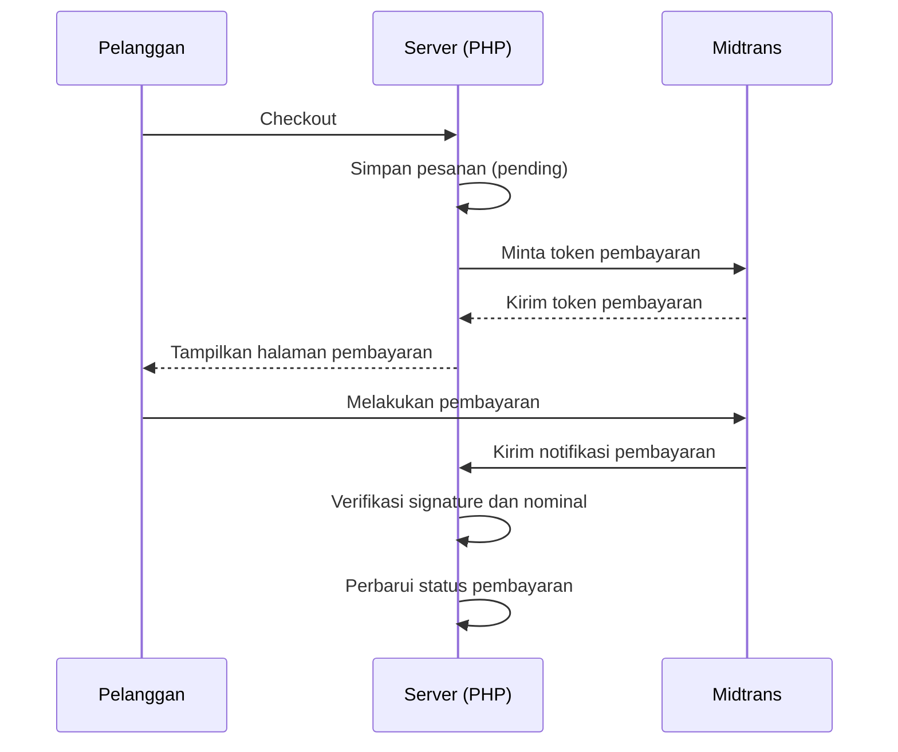
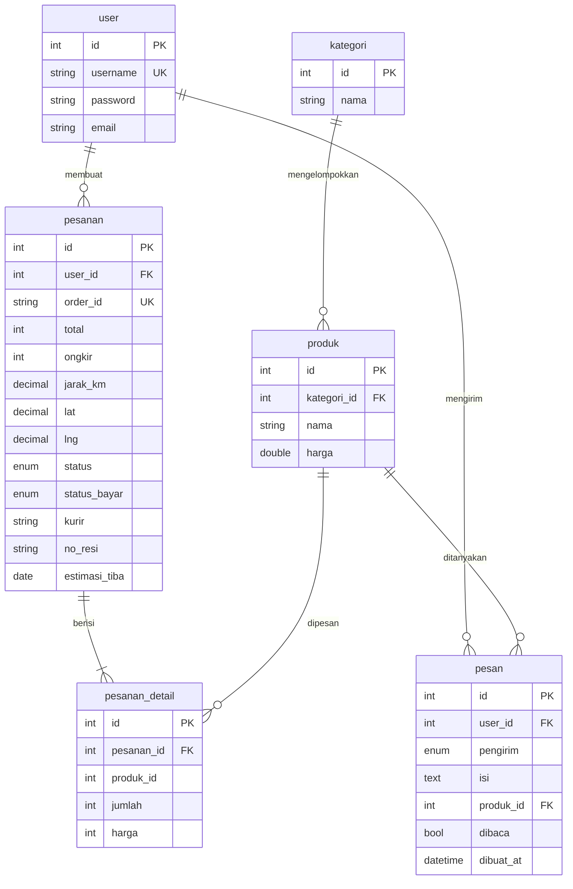

# Wins Beads — E-Commerce Aksesoris Manik-Manik

Wins Beads adalah website toko online untuk menjual aksesoris handmade, seperti gelang, bag charm, dan phone strap.

Website ini dibuat sebagai proyek portofolio untuk mempraktikkan pembuatan website toko online menggunakan PHP native dan MySQL. Website dilengkapi dengan halaman pelanggan, panel admin untuk mengelola toko, pembayaran online melalui Midtrans, serta fitur chat antara pelanggan dan admin.

## Tampilan Website

### Halaman Pelanggan


*Halaman utama website Wins Beads.*


*Halaman katalog untuk melihat dan mencari produk.*


*Halaman detail produk untuk melihat informasi produk sebelum membeli.*


*Halaman keranjang untuk melihat produk yang akan dibeli.*


*Tampilan pembayaran online menggunakan Midtrans.*


*Halaman untuk memantau perkembangan pesanan.*

### Halaman Admin


*Dashboard untuk melihat ringkasan toko.*


*Halaman untuk mengelola pesanan pelanggan.*


*Fitur komunikasi antara pelanggan dan admin.*

## Fitur Website

### 1. Fitur Pelanggan

- **Katalog produk:** melihat berbagai aksesoris, mencari produk berdasarkan nama, dan menyaring produk berdasarkan kategori.
- **Detail produk:** melihat informasi produk dan rekomendasi produk terkait.
- **Keranjang belanja:** menyimpan produk yang ingin dibeli sebelum checkout.
- **Registrasi dan login:** membuat akun dan masuk ke website. Password disimpan dalam bentuk hash agar tidak tersimpan sebagai teks biasa di database.
- **Checkout dan pembayaran:** melakukan pemesanan dan membayar melalui Midtrans, dengan metode yang tersedia seperti QRIS, virtual account, e-wallet, dan kartu.
- **Status pesanan:** memantau perkembangan pesanan melalui tahapan status, informasi kurir, nomor resi, dan perkiraan tanggal tiba.
- **Edit profil:** mengubah username, email, dan password.
- **Chat dengan admin:** bertanya tentang produk melalui tombol "Tanya Admin". Nama produk yang sedang dilihat akan ikut disertakan dalam percakapan.
- **Notifikasi chat:** mengetahui jumlah pesan yang belum dibaca dan melihat pesan yang sudah dibaca.
- **Pilih lokasi pengiriman:** menentukan alamat pengiriman melalui peta. Sistem menghitung perkiraan ongkos kirim berdasarkan jarak antara toko dan lokasi tujuan.

### 2. Fitur Admin

- **Dashboard:** melihat ringkasan informasi toko.
- **Kelola kategori dan produk:** menambah, melihat, mengubah, dan menghapus kategori maupun produk. Foto produk juga dapat diunggah melalui formulir yang dilengkapi validasi.
- **Kelola pesanan:** melihat pesanan beserta username pelanggan, mencari pesanan, mengurutkan daftar, menyaring berdasarkan status, dan berpindah halaman daftar pesanan.
- **Kelola pengiriman:** memperbarui status pesanan, mengisi nama kurir, nomor resi, dan perkiraan tanggal tiba.
- **Inbox chat:** melihat percakapan pelanggan, mengetahui jumlah pesan yang belum dibaca, dan membalas pesan langsung dari panel admin.

## Teknologi yang Digunakan

| Teknologi | Kegunaan |
|---|---|
| PHP 8 (native) | Mengatur logika website, proses pemesanan, dan komunikasi dengan database. |
| MySQL/MariaDB | Menyimpan data pengguna, produk, kategori, pesanan, dan pesan chat. |
| MySQLi & prepared statement | Menghubungkan PHP ke database dan membantu mencegah SQL injection. |
| Bootstrap 5 | Membantu membuat tampilan website yang rapi dan responsif. |
| Font Awesome | Menampilkan ikon pada halaman website. |
| Midtrans Snap | Menyediakan halaman pembayaran online. Integrasi dilakukan menggunakan cURL tanpa library Midtrans tambahan. |
| Leaflet & OpenStreetMap | Menampilkan peta untuk memilih lokasi pengiriman. |
| JavaScript & Fetch API | Memperbarui percakapan chat secara berkala tanpa harus memuat ulang halaman. |

## Alur Pembayaran

Website menggunakan Midtrans Snap untuk memproses pembayaran online. Berikut alur sederhananya:

1. Pelanggan menyelesaikan checkout dan mengirimkan data pengiriman.
2. Website menyimpan pesanan dengan status pembayaran awal `pending`, yang berarti pembayaran masih menunggu.
3. Server meminta token pembayaran kepada Midtrans menggunakan Server Key.
4. Pelanggan diarahkan ke tampilan pembayaran Midtrans dan memilih metode pembayaran yang tersedia.
5. Setelah pembayaran diproses, Midtrans mengirimkan pemberitahuan kepada server website.
6. Server memeriksa keaslian pemberitahuan dan nominal pembayaran sebelum memperbarui status pesanan.

Status pembayaran dapat berupa `pending`, `paid`, `failed`, atau `expired`, sesuai hasil yang diterima dan diproses oleh sistem.

Berikut diagram alur pembayarannya:



**Catatan:** Website juga memiliki mekanisme pengecekan status pembayaran melalui Midtrans Status API ketika pelanggan kembali ke toko. Mekanisme ini membantu pengecekan pembayaran pada lingkungan localhost, ketika server lokal belum dapat menerima webhook secara langsung.

## Struktur Database

Database `winsbeads` digunakan untuk menyimpan data yang dibutuhkan website. Berikut gambaran hubungan antartabelnya:

- `user`: menyimpan data akun pelanggan dan pengguna admin.
- `kategori`: menyimpan kategori produk.
- `produk`: menyimpan informasi produk dan kategori yang terkait.
- `pesanan`: menyimpan informasi pesanan, pembayaran, dan pengiriman.
- `pesanan_detail`: menyimpan daftar produk, jumlah, dan harga pada setiap pesanan.
- `pesan`: menyimpan pesan dalam percakapan pelanggan dan admin.

Diagram berikut menunjukkan hubungan antartabel berdasarkan rancangan database yang didokumentasikan:



*Catatan: diagram ini merupakan gambaran struktur database, bukan pengganti file SQL yang digunakan untuk membuat tabel beserta relasi dan constraint-nya.*

## Keamanan

Beberapa langkah keamanan diterapkan untuk membantu melindungi data pengguna dan proses transaksi:

- **Password:** menggunakan `password_hash()` untuk menyimpan password dalam bentuk hash dan `password_verify()` untuk memeriksa password saat login.
- **Keamanan query database:** menggunakan prepared statement pada query yang melibatkan input pengguna untuk membantu mencegah SQL injection.
- **Keamanan tampilan:** menggunakan `htmlspecialchars()` melalui helper `e()` untuk mencegah input pengguna ditampilkan sebagai kode HTML atau JavaScript berbahaya.
- **Perlindungan CSRF:** menggunakan token CSRF pada formulir POST untuk membantu mencegah permintaan perubahan data yang tidak diinginkan.
- **Session login:** mengganti ID sesi setelah login dan menggunakan cookie sesi dengan pengaturan `HttpOnly` serta `SameSite=Lax`.
- **Upload foto:** memeriksa ukuran dan tipe MIME file, serta mengganti nama file dengan nama acak.
- **Akses admin:** halaman admin dilindungi dengan pemeriksaan login.
- **Keamanan Midtrans:** kunci API disimpan dalam file konfigurasi lokal yang tidak disertakan dalam Git. Notifikasi pembayaran diverifikasi berdasarkan signature dan nominal transaksi. Status pembayaran yang sudah `paid` juga dilindungi agar tidak diturunkan oleh notifikasi berikutnya.

## Instalasi dan Menjalankan Website (XAMPP)

Ikuti langkah-langkah berikut untuk menjalankan Wins Beads di komputer lokal.

### Persiapan

Sebelum memulai, siapkan:

- XAMPP dengan PHP 8 dan MySQL/MariaDB.
- Browser seperti Google Chrome.
- Folder proyek Wins Beads.
- File database `winsbeads.sql` yang disertakan dalam proyek.

### Langkah 1 — Jalankan XAMPP

1. Instal XAMPP jika belum tersedia.
2. Buka **XAMPP Control Panel**.
3. Klik **Start** pada Apache dan MySQL.
4. Pastikan keduanya berhasil berjalan.

Apache digunakan untuk menjalankan website PHP, sedangkan MySQL digunakan untuk menyimpan data website.

### Langkah 2 — Salin folder proyek

1. Ekstrak file ZIP proyek jika masih dalam bentuk ZIP.
2. Salin folder proyek ke:

   `C:\xampp\htdocs\winsbeads\`

3. Pastikan file proyek berada langsung di dalam folder `winsbeads`, bukan di dalam folder hasil ekstraksi tambahan.

### Langkah 3 — Buat database dan impor data

1. Buka browser dan kunjungi `http://localhost/phpmyadmin/`.
2. Pilih menu **New** untuk membuat database baru.
3. Masukkan nama database `winsbeads`, lalu buat database.
4. Pilih database `winsbeads` yang baru dibuat.
5. Buka menu **Import**.
6. Pilih file `winsbeads.sql` dari folder proyek.
7. Klik **Import** atau **Go** untuk menjalankan proses impor.

Setelah proses berhasil, tabel-tabel yang dibutuhkan website akan tersedia di database.

### Langkah 4 — Atur koneksi database

Buka file:

`config/koneksi.php`

Sesuaikan konfigurasi koneksi dengan pengaturan MySQL di komputer kamu, seperti alamat server, username, password, dan nama database.

Untuk instalasi XAMPP standar, konfigurasi biasanya menggunakan:

- Host: `localhost`
- Username: `root`
- Password: kosong, jika belum diubah
- Database: `winsbeads`

Jika username atau password MySQL berbeda, sesuaikan dengan pengaturan di komputer kamu.

### Langkah 5 — Atur konfigurasi Midtrans

Website menggunakan Midtrans Snap untuk pembayaran online.

1. Buka dashboard Midtrans dan gunakan lingkungan **Sandbox** untuk pengujian.
2. Dapatkan Server Key dan Client Key Sandbox dari dashboard Midtrans.
3. Salin file `config/midtrans.local.example.php` menjadi `config/midtrans.local.php`.
4. Isi file lokal tersebut dengan Server Key dan Client Key Sandbox yang sesuai.
5. Pastikan file konfigurasi yang berisi kunci pribadi tidak diunggah ke repository publik.

Sandbox merupakan lingkungan pengujian sehingga kamu dapat mencoba alur pembayaran tanpa melakukan transaksi uang sungguhan.

### Langkah 6 — Aktifkan ekstensi cURL

cURL digunakan oleh PHP untuk mengirim permintaan ke layanan Midtrans.

1. Buka file `php.ini` melalui XAMPP Control Panel.
2. Cari baris konfigurasi ekstensi cURL.
3. Jika tertulis `;extension=curl`, hapus tanda titik koma di awal baris.
4. Simpan perubahan.
5. Restart Apache.

Jika cURL sudah aktif, langkah ini tidak perlu diubah.

### Langkah 7 — Buka website

Setelah konfigurasi selesai, buka:

`http://localhost/winsbeads/`

Jika halaman utama muncul, website sudah dapat diakses melalui komputer lokal.

### Akun Demo

Gunakan akun berikut untuk mencoba website, sesuai data akun demo yang disediakan dalam proyek:

| Peran | Username | Password |
|---|---|---|
| Pelanggan | `user` | `user12345` |
| Admin | `admin` | `admin` |

Halaman login admin dapat diakses melalui:

`http://localhost/winsbeads/admin/login-admin.php`

**Penting:** Ganti password admin setelah instalasi dan sebelum menggunakan akun tersebut untuk kebutuhan selain pengujian lokal.

### Jika Website Tidak Bisa Dibuka

Jika mengalami kendala, periksa beberapa hal berikut:

- **Halaman tidak ditemukan:** pastikan folder proyek berada di `C:\xampp\htdocs\winsbeads\` dan URL yang dibuka sudah benar.
- **Koneksi database gagal:** pastikan MySQL aktif, nama database benar, dan pengaturan di `config/koneksi.php` sesuai.
- **Fitur pembayaran bermasalah:** pastikan Server Key dan Client Key Sandbox sudah benar serta ekstensi cURL aktif.
- **Website menampilkan error PHP:** periksa pesan error dan konfigurasi PHP yang digunakan XAMPP.

## Pengujian Notifikasi Pembayaran di Localhost

Pada lingkungan lokal, server website belum tentu dapat menerima notifikasi pembayaran Midtrans secara langsung.

Untuk menguji webhook dari Midtrans:

1. Jalankan website di localhost.
2. Gunakan ngrok untuk menyediakan alamat HTTPS publik sementara yang mengarah ke server lokal.
3. Isi Payment Notification URL pada dashboard Midtrans Sandbox dengan alamat publik yang mengarah ke endpoint `midtrans-notif.php` di proyek.
4. Lakukan pembayaran uji dan periksa apakah status pembayaran diperbarui dengan benar.

Informasi lebih lengkap tersedia di [PANDUAN-MIDTRANS.md](PANDUAN-MIDTRANS.md).

**Catatan:** ngrok diperlukan untuk pengujian webhook dari layanan eksternal ke localhost, bukan untuk sekadar membuka dan menggunakan halaman website lokal. Mekanisme pengecekan melalui Status API juga tersedia sebagai cadangan ketika pelanggan kembali ke toko.

## Perhitungan Ongkos Kirim

Wins Beads menghitung perkiraan ongkos kirim berdasarkan jarak antara lokasi toko dan lokasi tujuan pelanggan.

- Lokasi toko dan tarif pengiriman dapat diatur melalui `config/toko.php`.
- Pengaturan bawaan menggunakan titik referensi di pusat Kota Medan.
- Tarif awal: Rp8.000 ditambah Rp2.500 per kilometer.
- Jarak maksimum pengiriman: 50 km.

Jarak dihitung menggunakan rumus Haversine, yaitu rumus untuk memperkirakan jarak antara dua titik berdasarkan koordinat geografis. Hasilnya dikalikan faktor jalan 1,3 untuk memperkirakan jarak perjalanan darat.

Ongkos kirim dibulatkan ke atas ke kelipatan Rp500.

Untuk menjaga konsistensi transaksi, browser hanya menampilkan pratinjau ongkos kirim. Server menghitung ulang ongkos kirim berdasarkan koordinat yang dikirim saat pesanan disimpan. Biaya pengiriman kemudian dimasukkan ke rincian pembayaran Midtrans agar total transaksi sesuai dengan jumlah yang harus dibayar.

**Catatan:** Perhitungan ini merupakan estimasi berbasis jarak, bukan tarif resmi dari perusahaan ekspedisi.

## Fitur Chat Pelanggan dan Admin

Fitur chat memungkinkan pelanggan bertanya mengenai produk dan admin membalas melalui panel admin.

- Pelanggan dapat membuka `chat.php` atau menekan tombol **Tanya Admin** pada halaman produk.
- Jika chat dibuka dari halaman produk, nama produk ikut disertakan dalam percakapan.
- Admin dapat melihat dan membalas pesan melalui `admin/chat.php`.
- Badge pada navbar menunjukkan jumlah pesan yang belum dibaca.

Chat memeriksa pesan baru secara berkala menggunakan Fetch API dan AJAX. Pemeriksaan dilakukan setiap 3 detik saat tab aktif dan setiap 15 detik saat tab tidak aktif. Dengan cara ini, chat dapat berjalan menggunakan PHP dan browser tanpa memerlukan server chat terpisah.

Beberapa perlindungan yang diterapkan:

- Sesi login digunakan untuk menentukan pemilik percakapan.
- Token CSRF digunakan ketika pesan dikirim.
- Isi pesan ditampilkan menggunakan `textContent` untuk membantu mencegah XSS.
- Panjang pesan dibatasi maksimal 1.000 karakter.
- Pengiriman dibatasi maksimal 20 pesan per menit.

## Struktur Folder

Gambaran singkat folder dan file utama:

```text
winsbeads/
├── config/
│   ├── koneksi.php
│   └── ... konfigurasi keamanan, Midtrans,
│       pesanan, ongkir, dan chat
├── admin/
│   └── ... halaman pengelolaan toko
├── assets/
│   ├── css/
│   ├── js/
│   └── ... gambar dan aset website
├── docs/
│   └── screenshots/
├── head.php
├── navbar.php
├── footer.php
├── PANDUAN-MIDTRANS.md
└── winsbeads.sql
```

Struktur di atas merupakan gambaran ringkas, bukan daftar seluruh file proyek.

---

**Wins Beads** dibuat sebagai proyek portofolio untuk mempraktikkan pengembangan website e-commerce menggunakan PHP native dan MySQL, termasuk pengelolaan produk, pemesanan, pembayaran online, pengiriman, dan komunikasi pelanggan.
